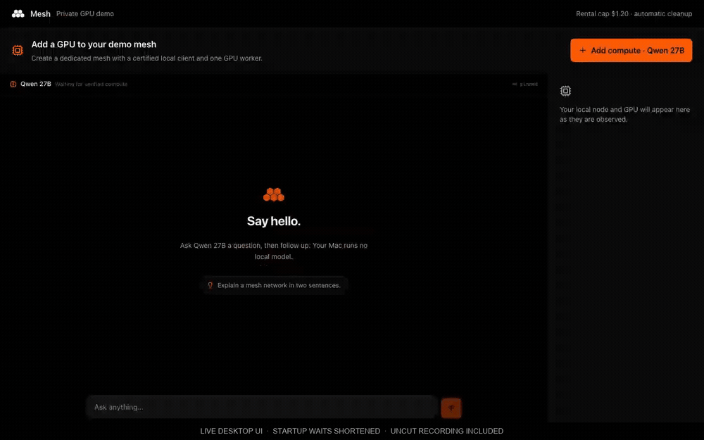

# m8s

Owner-controlled model workers using the actual **mesh-llm** node. The Rust
workspace contains lifecycle policy, durable accounting, provider adapters,
secure bootstrap/control, node supervision, a CLI, and a terminal dashboard.

## Desktop GPU demo

Add compute, watch a certified Qwen 27B worker join the mesh, hold a short
conversation, and remove the GPU with provider-confirmed teardown.

[](https://github.com/joabzzz/mesh-console/blob/demo/m8s-qwen27/docs/evidence/m8s-qwen27/demo.mp4)

30-second supercut; startup waits shortened. [Watch the 67-second demo](https://github.com/joabzzz/mesh-console/raw/refs/heads/demo/m8s-qwen27/docs/evidence/m8s-qwen27/demo.mp4)
or read the [setup and live evidence](docs/DESKTOP_DEMO.md). This capture uses
the desktop frontend against its running Tauri backend in a dedicated demo mesh.

## Proven prototype

On **2026-10-23**, the CLI deployed Vast instance **57330173**, delivered a
canonical node certificate over pinned direct iroh TLS, observed the model
through the owner client, obtained a real completion, destroyed the instance,
and independently confirmed its absence. The command exited successfully.

Evidence:

- [Complete demo receipt](deploy/container/demo-proof.json)
- [Independent inventory and cost observation](deploy/container/final-account-evidence.json)
- [Native model qualification](deploy/container/native-model-inference-evidence.json)
- [Published runtime provenance](deploy/container/listener-agent-evidence.json)

The tested model is **Qwen2.5-0.5B-Instruct Q4_K_M**, using the packaged CPU
runtime. Its API identity is the GGUF SHA-256 identity, not its filename.
That historical receipt does not qualify larger models or GPU performance;
Qwen3.8 27B has its separate live proof below. Final billing remains
unsettled; the accounting reservations are retained. Provider inventories were
empty after the demo.

## Build and run

Validated with **Rust 1.98**, macOS ARM64 for the owner, and Linux AMD64 for the
node image. Use a C compiler for bundled SQLite and at most two compiler jobs.

```sh
cargo build --workspace --locked -j 2
cargo build --locked -j 2 -p m8s-cli --features prototype-vast
```

The normal daemon remains a mock/development controller. Live Vast execution is
an explicit, default-off prototype command:

```sh
target/debug/m8s prototype launch --plan /absolute/private/new-attempt.json
```

The plan selects the owner binary, immutable image, credential **file path**,
account, exact ownership label, fresh run directory, and bounded budget. It must
account for previous spending and retained liabilities. See the
[CLI contract](crates/m8s-cli/README.md#one-attempt-vast-demo-default-off) and
[container documentation](deploy/container/README.md). A consumed attempt is
never reset or silently rented again.

The historical small-model image already contains the native node, CPU runtime, model,
restricted provisioning service, and control agent. That historical rental did not
compile Rust or fetch model weights separately. The Qwen3.8 image instead uses
the native download/cache flow described in its runbook. The owner's native client needs
the certified-identity fix at revision `7a101840af79c7509789b9e3152ca6c4605186e8`;
[the source integration record](deploy/container/native-source.json) identifies
its companion repository and the node image's source revision.

## How the live path works

1. Start a fresh certificate-enforcing owner client with no local model.
2. Read the selected account, complete inventories, and fresh offer pricing.
3. Persist budget reservation and create intent; arm independent exact-resource
   cleanup before the one-use provider create call.
4. Pin the SSH host key obtained from that exact instance's authenticated log
   request. Send nonce/node material through SSH stdin, never provider metadata.
5. Wait for the node's fixed listener acknowledgment, then authenticate direct
   iroh TLS, consume the nonce, deliver the certificate, and maintain heartbeats.
6. Discover the exact GGUF identity through the owner client and send one prompt.
7. Destroy the exact owned resource and independently confirm absence before
   returning the completion. Stop local processes and remove private run keys.

## Workspace

| Component | Responsibility |
| --- | --- |
| `m8s-core`, `m8s-config` | Policy, model fit arithmetic; configuration parsing |
| `m8sd` | SQLite intent/nonce/accounting journals and operation coordinators |
| `m8s-provider` | Provider contracts, Mock, feature-gated Vast/local adapters and node executable |
| `m8s-bootstrap` | Canonical identity bridge, direct TLS delivery and control |
| `m8s-agent` | Required-certificate native launch, supervision and dead-man switch |
| `m8s-cli` | Operator commands and dashboard; builds `m8s` and `m8s-top` |
| `m8s-api` | Shared local control protocol for daemon and operator clients |
| `m8s-secrets` | Explicit secret stores; no ambient discovery or silent fallback |

The workspace has ten crates. Model profiles and provider contracts are modules
in core; the persistent development mock belongs to `m8sd`. The dashboard is
a CLI module. Configuration, API, secrets, bootstrap and provider adapters remain
separate to keep their dependencies out of consumers that do not use them. The
agent, daemon and operator tools have distinct executable roles.

Core has no provider implementation or I/O dependency. Money uses micro-USD; capacities use bytes;
network rates use Mbps. Policy time is injected. Secret values are excluded from
Debug/Serialize and never placed in command arguments or logs. Only public node
certificates and node keys reach workers; owner signing keys stay with the owner.

## Checks

```sh
scripts/check --no-pty --no-acl-mutation
python3 -B -m unittest discover -s deploy/container/tests -v
```

GitHub Actions runs on pull requests targeting `main`. CI uses the check profile
above, validates the profile selection, tests the container tooling, and runs
`scripts/mock-e2e` to exercise creation, scaling, restart adoption, and confirmed
removal with the development controller. These checks use synthetic fixtures
and mocks; live provider deployment and inference remain separate qualification.

The Qwen integration passed **804 Rust tests**, formatting, strict Clippy and
**24 Python tests**. Linux CI also passed the current code.
Five tests remained ignored and seven were filtered. The mock end-to-end demo
also passed creation, scale, restart adoption and confirmed removal. The
selected profile excludes four synthetic PTY tests and three ACL-mutation tests;
it is not an unfiltered OS qualification. Existing operator endpoint evidence is
retained and was not rerun. `scripts/check` without flags retains the normal
selection. See `scripts/check --help` and the crate READMEs for exact boundaries.

## Qwen3.8 27B live demo

The exact **Qwen3.8 27B UD-Q4_K_M** model completed a real owner-routed request
through mesh-llm using `m8sd --vast-demo` and `m8s up`, `scale`, `status`, `logs`
and `down`. Vast instance **57433800** was destroyed and full instance/volume
inventories were verified empty. See the [repeatable runbook](docs/QWEN38_DEMO.md),
[sanitized live proof](deploy/container/qwen38-live-proof.json) and
[account observation](deploy/container/qwen38-final-account-evidence.json).

This is the explicit bounded prototype mode: one attempt, text-only, context 4096,
no automatic replacement or production Ready claim. Its image downloads weights
through the native runtime during the billed lease; it does not compile Rust
on the rental. Final billing remains unsettled with conservative liabilities
recorded. The default mock controller is still development-only.

## Development controller

```sh
target/debug/m8sd /private/tmp/m8s-example owner-example
# Another terminal:
target/debug/m8s --socket /private/tmp/m8s-example/control.sock up mock-demo --json
target/debug/m8s --socket /private/tmp/m8s-example/control.sock status --json
target/debug/m8s --socket /private/tmp/m8s-example/control.sock down --json
```

`mock-demo` is a development tier label, with no upstream model mapping. The
previous `qwen27` example was also only a tier label.
This path reports mock/development state. A mock Booting node is not a live Ready
node. Stopped is not destroyed, destroy acknowledgment is not absence, and an
uncertain provider response never authorizes deleting a resource row or releasing
its liability. The live prototype is not yet a production fleet scheduler.

## Architecture and next work

The [original roadmap and ADRs](docs/original/README.md) are preserved with source
versions and hashes; the [implementation map](docs/ORIGINAL_PLAN_STATUS.md) tracks
their remaining acceptance criteria. The [decision index](docs/decisions/README.md)
records the prototype choices and subsequent source integration with their evidence. The [production roadmap](docs/ROADMAP.md) separates
completed acceptance from remaining integration and operational qualification.
A [continuation handoff](docs/CONTINUATION_HANDOFF.md) records the latest local
checkpoint, validation, current restrictions and a ready-to-use session prompt.

## Agent demo skill

Ask an agent: **“Use $m8s-demo to explain the proof and help me run a fresh bounded demo.”**
The repo-local [skill](.agents/skills/m8s-demo/SKILL.md) includes the artifact pins,
[runbook](.agents/skills/m8s-demo/references/run-demo.md), accounting constraints,
and failure/cleanup workflow. If the agent does not discover repo-local skills,
ask it to read that file explicitly. A new rental needs a current budget; reading
the proof does not make provider calls.
